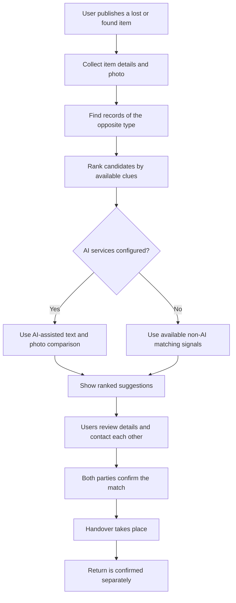
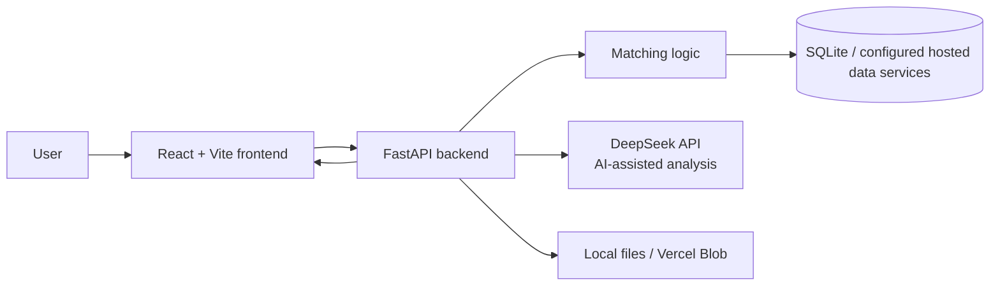

# Shijian (拾见) — Lost & Found

<p align="center">
  <strong>A multilingual community lost-and-found platform that helps people reconnect with their belongings.</strong>
</p>

<p align="center">
  
  
  
  
</p>

Shijian (拾见) is a multilingual lost-and-found application for communities. Users can publish lost or found items, browse related clues, review ranked match suggestions, contact record owners privately, and confirm when an item has been returned.

> **Important:** Match suggestions are leads to review—not proof of ownership. Users should verify item-specific details and confirm a handover themselves.

## Contents

- [Why Shijian?](#why-shijian)
- [Key Features](#key-features)
- [How Matching Works](#how-matching-works)
- [Supported Languages](#supported-languages)
- [Technology Stack](#technology-stack)
- [System Architecture](#system-architecture)
- [Getting Started](#getting-started)
- [Project Structure](#project-structure)
- [Privacy and AI Data Use](#privacy-and-ai-data-use)
- [Current Limitations](#current-limitations)

## Why Shijian?

When someone loses an item, useful clues may be scattered across different posts and written in different languages. Shijian brings those clues together in one community workflow and helps users identify promising matches without treating an automated result as a final decision.

## Key Features

| Feature | What it does |
|---|---|
| Lost and found posts | Publish a photo, category, approximate location, time, and identifying details. |
| Ranked match suggestions | Review potentially related records of the opposite type. |
| AI-assisted text support | When configured, normalize submitted text to support cross-language comparison. |
| AI-assisted photo comparison | Analyze item photos and compare photos among stronger candidates when AI services are available. |
| Private contact requests | Contact the owner of a record through an in-app request. |
| Notifications | See contact requests, match confirmations, and return updates in the app. |
| Record management | Manage, close, or delete your own records. |
| Confirmed returns | Both parties can confirm a match and separately confirm the handover. |
| Responsive interface | Use the application on desktop or mobile. |

## How Matching Works

Shijian ranks potentially relevant records using information supplied by users. When AI services are configured and available, AI-assisted text and photo analysis can provide additional comparison signals.



Matching signals may include:

- Item category
- Approximate location
- Time information
- Color
- Item description
- AI-assisted text normalization and photo comparison, when configured and available

**A suggested match does not automatically prove that an item belongs to someone.** The people involved should verify distinctive details and confirm the handover.

## Supported Languages

The interface supports:

- English (default)
- Simplified Chinese
- Bahasa Melayu
- Tamil
- Thai

The selected interface language is saved in the current browser.

## Technology Stack

| Area | Technology |
|---|---|
| Frontend | React 18, Vite, Three.js, Lucide React |
| Backend API | Python, FastAPI |
| Local data storage | SQLite and local file system |
| Hosted database and authentication | Neon |
| Hosted file storage | Vercel Blob |
| AI-assisted analysis | DeepSeek API |

## System Architecture



The exact storage path depends on the local or hosted configuration. Keep provider credentials in environment configuration rather than committing secrets to source control.

## Getting Started

### Requirements

- Node.js 20 or later
- Python 3.10 or later

The commands below use PowerShell on Windows.

### 1. Set up the backend

From the project root, create and activate a virtual environment:

```powershell
python -m venv .venv
.\.venv\Scripts\Activate.ps1
python -m pip install -r requirements.txt
```

Start the FastAPI server:

```powershell
python -m uvicorn app.main:app --reload --port 8000
```

### 2. Set up the frontend

Open a second terminal in the project root:

```powershell
npm install
npm run dev
```

Open the frontend at:

- **Application:** <http://localhost:5173>
- **API documentation:** <http://localhost:8000/docs>
- **API health check:** <http://localhost:8000/api/health>

The Vite development server forwards API and uploaded-image requests to the local FastAPI server.

### Configuration notes

- Authentication is required for publishing and managing personal records.
- AI-assisted analysis requires the backend AI service to be configured.
- Hosted services such as Neon and Vercel Blob may require their own environment configuration.
- Use the project's existing environment-variable names and setup instructions when configuring credentials.
- **Never commit API keys, database credentials, or other secrets to GitHub.**

## Project Structure

```text
app/                 FastAPI application and matching logic
frontend/            React pages, components, styles, and translations
public/              Built frontend assets served by the application
scripts/             Data preparation and evaluation utilities
requirements.txt     Python dependencies
package.json         Frontend dependencies and commands
vite.config.js       Frontend development and build configuration
```

## Available Commands

| Command | Purpose |
|---|---|
| `npm run dev` | Start the Vite development server |
| `npm run build` | Build the frontend into `public/` |
| `python -m uvicorn app.main:app --reload --port 8000` | Start the local FastAPI API |

## Privacy and AI Data Use

- Photos and clue details appear on the public community board. Do not post home addresses, identity numbers, or other sensitive information.
- Contact requests and match updates appear in the in-app notification inbox and **My Records**.
- The application does not send email or browser push notifications, according to the current project documentation.
- When AI analysis is enabled, submitted photos and text are sent to DeepSeek for analysis and matching support.
- The original text remains the version shown in the application.
- AI-generated analysis and similarity signals can be incomplete or incorrect. Verify important details independently.

## Current Limitations

- Match suggestions depend on the quality and completeness of user-submitted information.
- AI-assisted analysis depends on correct service configuration and provider availability.
- A high-ranked result should not be treated as verified ownership.
- Users are responsible for arranging and verifying the physical handover safely.

---

<p align="center">
  <sub>Shijian (拾见) — helping communities reconnect people with their lost belongings.</sub>
</p>
