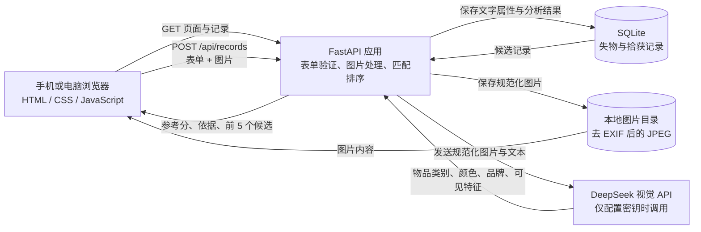

# 系统架构与数据流（当前 MVP）

> 本图和说明描述仓库当前实现。它是本地原型架构，不等于正式公开部署方案。

## 组件

## 发布一条记录

1. 浏览器向 `POST /api/records` 发送失物/拾获类型、标题、类别、颜色、粗略地点、时间、说明和图片。
2. FastAPI 验证必填字段和长度；图片限制为 8 MB、JPG/PNG/WebP，最大边长 8000 像素。
3. Pillow 校正图片方向、转成 JPEG、缩小到最长边 1800 像素并重新编码；重新编码会移除原图片 EXIF 元数据。
4. 规范化图片保存到本地 `work/app_data/uploads/`。
5. 若设置 `DEEPSEEK_API_KEY`，后端把规范化图片和用户填写的文字发给 DeepSeek，要求返回 JSON 形式的物品类别、颜色、可见品牌和特征。未配置或调用失败时，记录仍可保存，分析状态会记录为未配置或不可用。
6. 文本信息、图片文件名、模型属性和分析状态保存到 `work/app_data/lost_found.sqlite3`。
7. 系统读取相反类型的记录，按表单类别、地点、时间，以及照片分析类别、颜色、品牌和特征计算启发式参考分，并返回前 5 条候选及匹配依据。参考分不是配对概率。

## 当前接口

- `GET /`：返回网页。
- `GET /api/records`：列出最近记录；可以用 `kind` 筛选 `lost` 或 `found`。
- `POST /api/records`：创建记录并返回最多 5 个候选匹配。
- `GET /uploads/{filename}`：返回本地图片。文件名必须符合随机十六进制 ID 格式。

## 数据边界与限制

- 当前没有账号、登录、认领验证、私信、审核或访问控制；图片链接可由访问应用的人读取。因此适合本地演示，不适合直接公开上线。
- DeepSeek 只在新记录发布时提取一次属性；匹配时不再逐张发送候选图片给模型。
- 当前匹配排序在 FastAPI 进程内完成，并扫描相反类型的记录；不是向量数据库，也不是经过验证的概率。
- SQLite、上传图片和应用运行在同一台机器；没有云端备份、扩展存储或多实例协调。
- 后端同步调用外部视觉 API，设置了 35 秒超时；高并发或服务延迟时可能拖慢发布请求。
- 图片去除 EXIF 并不能去除画面中可能出现的人脸、证件或其他敏感信息；若启用 API，也要按学校批准的流程确认第三方图片处理。

## 公开演示准备

- `APP_DATA_DIR` 可以把 SQLite 和上传图片目录移动到云端持久盘；本地默认仍是 `work/app_data`。
- 根目录 `render.yaml` 预设一个单实例 Render 部署，并设置 `DEEPSEEK_MODEL=deepseek-flash`（DeepSeek-V4.1-Flash）和健康检查。
- 当前 Render 配置尚未部署；单实例持久盘适合小型 FYP 演示，不能横向扩展。部署说明见 [`PUBLIC_DEPLOYMENT_GUIDE.md`](PUBLIC_DEPLOYMENT_GUIDE.md)。
- 上传表单说明了记录/照片的公开范围及启用 AI 时会把照片发送给 DeepSeek。

## 未来正式部署前仍需处理

优先补账号与权限、图片私有访问、滥用防护、速率限制、日志中的敏感信息处理、删除与保留流程、HTTPS、数据库备份、文件存储策略和异步 API 调用。多人使用时再评估 PostgreSQL、对象存储和任务队列；这些不是当前 MVP 已实现的功能。
