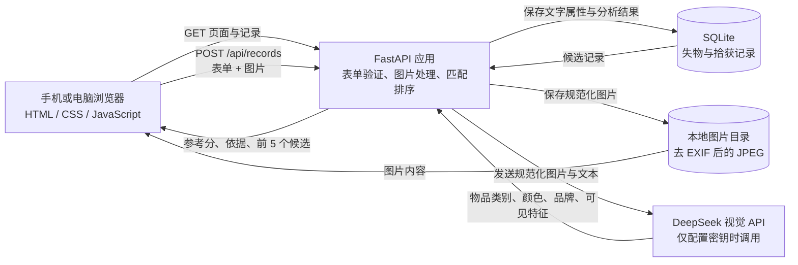

# 系统架构与数据流（当前 MVP）

> 本图描述本地运行时的数据流。部署环境可把本地 SQLite/图片目录替换成 Neon PostgreSQL/Vercel Blob。

## 组件

## 发布一条记录

1. 浏览器向 `POST /api/records` 发送失物/拾获类型、标题、类别、颜色、粗略地点、时间、说明和图片。
2. FastAPI 验证必填字段和长度；图片限制为 8 MB、JPG/PNG/WebP，最大边长 8000 像素。
3. Pillow 校正图片方向、转成 JPEG、缩小到最长边 1800 像素并重新编码；重新编码会移除原图片 EXIF 元数据。
4. 本地运行时，规范化图片保存到 `work/app_data/uploads/`；配置 `BLOB_READ_WRITE_TOKEN` 时则上传到 Vercel Blob。
5. 若设置 `DEEPSEEK_API_KEY`，后端把规范化图片和用户填写的文字发给 DeepSeek，要求返回 JSON 形式的物品类别、颜色、可见品牌和特征。未配置或调用失败时，记录仍可保存，分析状态会记录为未配置或不可用。
6. 文本信息、图片 URL、模型属性和分析状态保存到本地 `work/app_data/lost_found.sqlite3`，或配置 `DATABASE_URL` 后保存到 PostgreSQL。
7. 系统读取相反类型的记录，按类别、地点、时间和已提取属性先排序，选出最多 5 条候选。配置 DeepSeek 时，再把新照片和候选照片放入同一多图请求，让模型比较具体物品外观，并按综合参考分重排；API 未配置、候选图片无法读取或请求失败时，保留属性排序结果。参考分不是配对概率。

## 当前接口

- `GET /`：返回网页。
- `GET /api/records`：列出最近记录；可以用 `kind` 筛选 `lost` 或 `found`。
- `POST /api/records`：创建记录并返回最多 5 个候选匹配。
- `GET /uploads/{filename}`：返回本地图片。文件名必须符合随机十六进制 ID 格式。

## 数据边界与限制

- 当前没有账号、登录、认领验证、私信、审核或访问控制；图片链接可由访问应用的人读取。因此适合本地演示，不适合直接公开上线。
- DeepSeek 在新记录发布时提取属性，并可在排序后比较新照片与最多 5 张候选照片。多图请求会增加图片 token 用量；候选筛选用于控制调用规模。
- 当前先在 FastAPI 进程内扫描并排序相反类型的记录，再让 DeepSeek 比较候选图；不是向量数据库，也不是经过验证的概率。
- 本地开发默认使用 SQLite 和本地图片；部署时需配置 Neon PostgreSQL 与 Vercel Blob。仓库有对应适配代码，但尚未连接云端资源或部署验证。
- 后端同步调用外部视觉 API：属性提取超时 35 秒，候选图读取和比较也需要等待；Vercel Function 设为最长 180 秒。慢响应仍可能拖慢发布请求。
- 图片去除 EXIF 并不能去除画面中可能出现的人脸、证件或其他敏感信息；若启用 API，也要按学校批准的流程确认第三方图片处理。

## Vercel 公开部署目标

- 用户指定使用 Vercel。目标方案为 Vercel FastAPI Function + Neon PostgreSQL（记录）+ Vercel Blob（照片）。
- 代码已支持通过 `DATABASE_URL` 与 `BLOB_READ_WRITE_TOKEN` 切换到 Neon/PostgreSQL 和 Vercel Blob，另有 `app/app.py` Function 入口及 `public/` 网页资源。
- 浏览器会把大于 4 MiB 的图片压缩后再提交，以适应 Vercel Function 4.5 MB 请求正文限制；服务端单张图片上限仍为 8 MB。
- 尚未在 Vercel 配置存储或部署，旧本地 SQLite 记录和图片也不会自动迁移。
- 部署步骤和限制见 [`PUBLIC_DEPLOYMENT_GUIDE.md`](PUBLIC_DEPLOYMENT_GUIDE.md)。
- 上传表单说明了记录/照片的公开范围及启用 AI 时会把照片发送给 DeepSeek。

## 未来正式部署前仍需处理

上线前优先补账号与权限、图片私有访问、滥用防护、速率限制、日志中的敏感信息处理、删除与保留流程、数据库备份和异步 API 调用。当前网站允许访客发布并读取公开记录，作为开放演示需留意滥用与成本。
