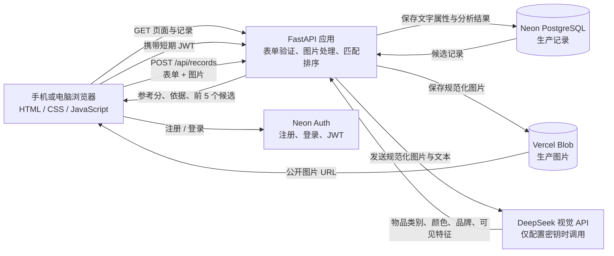

# 系统架构与数据流（当前 MVP）

> 网站已部署到 Vercel。生产环境使用 Neon PostgreSQL、Vercel Blob 和 Neon Auth；本地开发仍可使用 SQLite 与本地图片目录。

## 组件

## 发布一条记录

1. 浏览器向 `POST /api/records` 发送失物/拾获类型、标题、类别、颜色、粗略地点、时间、说明和图片。
2. FastAPI 验证必填字段和长度；图片限制为 8 MB、JPG/PNG/WebP，最大边长 8000 像素。
3. Pillow 校正图片方向、转成 JPEG、缩小到最长边 1800 像素并重新编码；重新编码会移除原图片 EXIF 元数据。
4. 本地运行时，规范化图片保存到 `work/app_data/uploads/`；配置 `BLOB_READ_WRITE_TOKEN` 时则上传到 Vercel Blob。
5. 只有发布者勾选逐条 AI 处理同意且设置了 `DEEPSEEK_API_KEY` 时，后端才把规范化图片和用户填写的文字发给 DeepSeek，要求返回 JSON 形式的物品类别、颜色、可见品牌和特征。未同意、未配置或调用失败时，记录仍可保存并使用表单信息匹配。旧记录迁移后默认为未同意。
6. 文本信息、图片 URL、模型属性和分析状态保存到本地 `work/app_data/lost_found.sqlite3`，或配置 `DATABASE_URL` 后保存到 PostgreSQL。
7. 系统读取相反类型的记录，按类别、地点、时间和已提取属性先排序，选出最多 5 条候选。只有当前记录及候选记录双方均已同意 AI 处理时，才把这些照片放进多图请求比较外观；其他候选仍可按表单/属性信息排序，但不会读取其照片发给模型。API 未配置、候选图片无法读取或请求失败时，保留属性排序结果。参考分不是配对概率。

## 当前接口

- `GET /`：返回网页。
- `GET /api/records`：列出最近记录；可以用 `kind` 筛选 `lost` 或 `found`。
- `POST /api/records`：创建记录并返回最多 5 个候选匹配。
- `GET /uploads/{filename}`：返回本地图片。文件名必须符合随机十六进制 ID 格式。

## 数据边界与限制

- Neon Auth 管理注册、登录和会话；新增记录需要登录。后端验证 JWT；关闭、删除和列出个人记录时会按登录用户 ID 限制。访客可浏览公开记录和图片。
- 当前没有认领验证、私信或管理员审核；用户不能证明他人发布的记录属于自己。公开 Blob 图片链接可由任何能访问链接的人读取。
- DeepSeek 仅处理逐条同意 AI 处理的记录照片/说明；候选照片须由双方记录者同意。多图请求会增加图片 token 用量；候选筛选用于控制调用规模。此应用授权不替代学校伦理审批或研究同意。
- 当前先在 FastAPI 进程内扫描并排序相反类型的记录，再让 DeepSeek 比较候选图；不是向量数据库，也不是经过验证的概率。
- 本地开发默认使用 SQLite 和本地图片；公开部署已连接 Neon PostgreSQL 与 Vercel Blob。应用健康与页面可访问性已检查；注册至发布、AI 匹配和删除的完整线上流程仍需逐项验收。
- 后端同步调用外部视觉 API：属性提取超时 35 秒，候选图读取和比较也需要等待；Vercel Function 设为最长 180 秒。慢响应仍可能拖慢发布请求。
- 图片去除 EXIF 并不能去除画面中可能出现的人脸、证件或其他敏感信息；若启用 API，也要按学校批准的流程确认第三方图片处理。

## Vercel 公开部署

- 用户指定使用 Vercel。目标方案为 Vercel FastAPI Function + Neon PostgreSQL（记录）+ Vercel Blob（照片）。
- 代码已支持通过 `DATABASE_URL` 与 `BLOB_READ_WRITE_TOKEN` 切换到 Neon/PostgreSQL 和 Vercel Blob，另有 `app/app.py` Function 入口及 `public/` 网页资源。
- 浏览器会把大于 4 MiB 的图片压缩后再提交，以适应 Vercel Function 4.5 MB 请求正文限制；服务端单张图片上限仍为 8 MB。
- 网站当前已部署在 Vercel；旧本地 SQLite 记录和图片不会自动迁移。
- 部署步骤和限制见 [`PUBLIC_DEPLOYMENT_GUIDE.md`](PUBLIC_DEPLOYMENT_GUIDE.md)。
- 上传表单说明了记录/照片的公开范围及启用 AI 时会把照片发送给 DeepSeek。

## 当前未完成和未来增强

尚未实现认领验证、管理员审核、私有图片访问、通知和模型异步任务。用户决定暂不处理应用自定义登录尝试限流。当前部署是 FYP 演示原型；使用真实研究参与者或个人图片前，仍需导师/学校批准数据处理方案，并确认备份、删除与第三方 API 使用安排。访客只能浏览公开记录，发布和管理记录需要登录。
