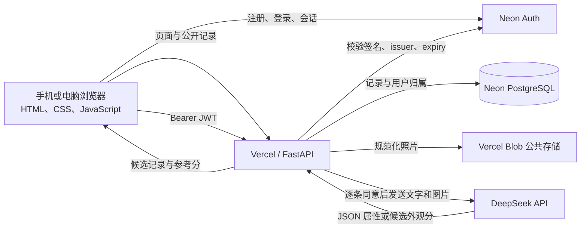

# 第四章：系统设计与实现（草稿）

> 本章按仓库当前实现撰写，描述的是演示原型而非已完成的生产级失物服务。代码中存在某项功能，不代表该功能已经通过完整线上验收。真实参与者数据、正式研究图片或公开招募须先完成导师和学校要求的审查与批准。

## 4.1 系统目标与范围

系统面向手机和电脑浏览器，允许访客浏览公开的失物与拾获记录，允许登录用户发布记录及管理本人记录。每条记录包含物品类型、标题、类别、颜色、粗略地点、发生时间、补充描述和照片。系统只返回另一类型记录中的若干候选，不确认物品所有权，也不代替用户或失物招领人员核实身份。

原型的重点是比较表单属性、图片提取属性和候选照片比较对候选排序的影响。它没有认领核验、站内私信、管理员审核、通知或人工裁决流程。

## 4.2 总体架构

前端是静态 HTML、CSS 和 JavaScript 页面，由 Vercel 提供；服务端使用 Python FastAPI，通过 `app/app.py` 暴露给 Vercel Function。云端通过 `DATABASE_URL` 使用 Neon PostgreSQL，通过 `BLOB_READ_WRITE_TOKEN` 保存图片；本地开发可用 SQLite 和本地上传目录。登录注册由 Neon Auth 托管，后端使用 JWKS 验证客户端 JWT，并以 JWT 的 subject 作为记录所有者标识。

## 4.3 页面和用户流程

首页提供公开记录浏览和发布入口。登录页面调用 Neon Auth 完成账号注册或登录。个人记录页面请求需要登录的 `/api/me/records`，并提供关闭公开展示或删除本人记录的操作。发布表单要求登录后提交；公开记录列表最多返回最近 100 条有效记录，个人记录接口也有限制返回数量。

主要 API 包括：

| 路由 | 用途 | 访问控制 |
| --- | --- | --- |
| `GET /`、`GET /login`、`GET /my-records` | 返回页面 | 公开 |
| `GET /api/health`、`GET /api/config` | 健康与公开配置状态 | 公开；不返回密钥 |
| `GET /api/records` | 浏览公开有效记录，可按类型筛选 | 公开 |
| `GET /api/me/records` | 列出当前用户的记录 | 有效 JWT |
| `POST /api/records` | 创建记录并返回至多五个候选 | 有效 JWT |
| `PATCH /api/records/{id}/close` | 关闭本人记录 | 有效 JWT 且校验所有者 |
| `DELETE /api/records/{id}` | 删除本人记录及对应图片 | 有效 JWT 且校验所有者 |
| `GET /api/cron/expire` | 清理到期记录 | Vercel Cron Bearer secret |

## 4.4 图片处理和数据保存

服务端接收 JPG、PNG 或 WebP，限制原始图片不超过 8 MB、单边不超过 8000 像素。Pillow 根据 EXIF 方向修正图像，将其转换为 RGB、缩小至最长边 1800 像素，并重新编码为 JPEG。重新编码可去除 EXIF 元数据，但不能清除图像画面中可见的人脸、证件或其他敏感内容。浏览器还会压缩较大的照片，以适应 Vercel Function 的请求体限制。

云端照片写入 Vercel Blob，数据库保存其 URL 和记录字段；Blob 当前为公开访问，因此任何取得图片 URL 的人都可能读取图片。文字记录保存在 Neon PostgreSQL。记录按创建时间设定 90 天到期时间；每日 Cron 路由会尝试删除对应图片和记录。若图片删除失败，该条数据库记录不会在该次清理中删除。虽然代码包含到期逻辑，仍缺少已验证的线上 Cron 执行、图片删除与记录清理端到端证据。

本地运行时，记录保存在 SQLite，照片保存在本地上传目录。云端旧数据不会自动从本地迁移。当前已有两条合成测试记录，用户已明确要求暂时保留；这些记录不构成研究数据或实验结果。

## 4.5 候选匹配与排序

系统仅将失物与拾获记录互相比较，忽略同类型记录、已关闭记录、已过期记录和记录自身。第一阶段对有效反向候选计算表单/属性启发式分，并选出前五名。信号权重为用户类别 22 分、地点相似度 20 分、时间相似度 15 分、视觉类别 10 分、颜色 12 分、品牌 8 分，以及特征和描述 13 分。地点等文本相似度使用词集合 Jaccard 与 `SequenceMatcher` 的较大值；时间项在 30 天范围内线性衰减。缺失属性不额外得分，满分限制为 100。相同分数按记录 ID 稳定排序。

只有配置 DeepSeek API key、当前记录同意 AI 处理且候选记录也同意 AI 处理时，第二阶段才读取候选照片。模型接收当前图片和至多五张候选图片，输出外观相似参考分、可见证据及不确定点。综合分为启发式分的 45% 加照片比较分的 55%，随后重新排序。未同意的候选不会把其保存的视觉属性用于当前查询，也不会将其图片发送给模型。候选图片不可读取、模型未配置或调用失败时，系统保留可用的较早阶段排序。

上述分值是启发式排序和模型判断的组合，不是统计概率，也没有通过真实标注数据调优或校准。用户必须自行核对颜色、磨损、配件、地点与时间，系统不能据此确认物品属于某人。

## 4.6 DeepSeek 图像分析与数据同意

用户发布时可逐条选择是否允许 AI 处理。选择同意后，服务端使用配置的模型 ID（默认 `deepseek-flash`）请求 Chat Completions，发送重编码后的记录照片和标题、类别、描述，要求返回 JSON 格式的类别、颜色、可见品牌和特征。选择不同意时，记录仍可保存并使用表单信息排序。若分析失败，记录以未分析状态继续保存。照片比较还要求参与比较的两条记录都具有相应同意标记。

API 密钥只在服务端环境变量中使用，不发送给浏览器。当前日志避免记录图片、完整提示词、提供商错误正文和密钥。应用内的同意开关仅控制此软件的调用路径，不能替代学校伦理审查、参与者研究同意或对 DeepSeek 数据处理方式的确认。

## 4.7 安全与隐私措施

- 写入、个人列表、关闭和删除操作都要求有效 JWT；关闭和删除使用当前登录用户 ID 限定记录归属。
- 输入字段长度、枚举类别、日期和图片格式经过服务端验证；数据库访问使用参数化查询。
- 图片名由随机标识生成；本地上传路由仅接受符合格式的文件名。
- 关闭记录只将状态改为非活动，不会立即删除数据；用户主动删除时，后端尝试一并移除 Blob 图片。
- 公开浏览意味着记录字段和图片 URL 可由访客访问；当前没有私有图片访问控制、内容审核或所有权验证。
- 记录默认设定 90 天期限，但备份、第三方保留和生产清理结果还需另外核对。

## 4.8 部署与运行限制

项目部署在 Vercel，依赖 Neon PostgreSQL、Neon Auth 和 Vercel Blob 的项目级环境变量。DeepSeek API key 也必须配置在服务端环境。若云端数据库或图片存储未配置，发布接口会拒绝创建记录。Vercel Function 配置了最长 180 秒运行时间；图像属性分析、读取候选图片和多图比较都是同步流程，因而较慢的模型响应可能延迟发布结果。当前候选数量限制减轻了请求负担，但没有异步任务队列。

## 4.9 实现状态和验收边界

代码审查确认了上述路由、存储切换、JWT 校验、图片规范化、同意控制、匹配和清理实现。既有生产验收记录确认：Neon Auth trusted domain 包含生产域名；一次性验收账号成功注册并进入个人记录页；两条明确标记为合成数据的记录成功发布，数据库保存和 Blob 图片读取正常，基础表单匹配返回候选。未登录时个人记录接口返回 401。用户要求暂时保留这两条合成记录。2026-10-11 的只读状态复核确认页面与主要只读路由仍可访问；该复核未查看记录内容、也未更改数据。

这证明了一次性注册和合成数据发布/基础匹配路径可用，但不是不同浏览器、账号或负载下的广泛验收。获准 AI 处理的一条合成记录调用返回 `unavailable`；没有证据证明 DeepSeek 属性分析或候选多图比较成功。跨账号隔离、关闭、删除、Cron 实际到期清理及 AI 成功仍需分别验收。曾出现的注册 `Invalid origin` 在 trusted domain 核对后的一次性注册中未再出现，不能继续写成当前已知阻塞；历史 HTTP 404/500 也不能单凭一次成功流程认定在所有环境均已消除。论文应据此区分代码实现与有限验收结果。

## 4.10 本章小结

本章说明了原型的浏览器、FastAPI、认证、数据库、图片存储和视觉 API 组件，以及从图片预处理到候选排序的路径。当前实现提供了由规则分数和可选多图比较组成的候选排序，并对登录用户的个人记录操作和 AI 处理同意设置了控制。其主要限制是公开图片链接、同步模型调用、未验证的权重和尚未完成的线上端到端验收。系统适合作为后续受控实验的原型，但是否可用于研究数据采集仍取决于导师和学校批准。

### 定稿前需补充

1. 导师批准后的最终需求和架构图。
2. 去敏后的 Vercel、Neon、Auth 和 Blob 配置/验收证据；禁止放入密钥或真实个人图片。
3. 按正式测试逐项填写的生产验收记录，包括失败情形和修复版本。
4. 学校要求的隐私、伦理和第三方数据处理表述。
